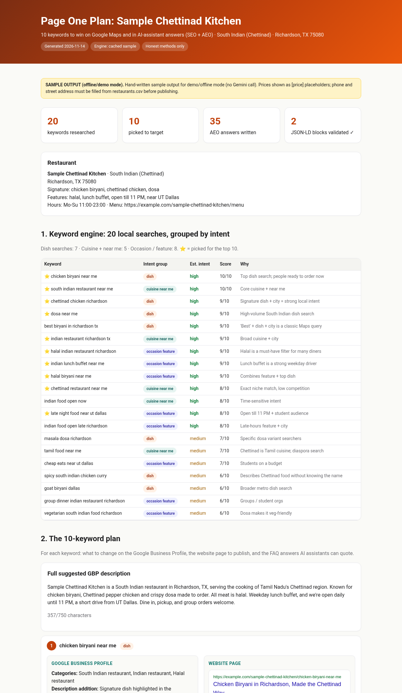

# Page One Builder — 10 Keywords on Google Maps (SEO + AEO)

**The problem:** most independent restaurants are invisible when someone types "chicken biryani near me" into Google Maps or asks ChatGPT / Gemini "where's a good halal South Indian place near UT Dallas?" Their Google Business Profile is thin, their website has no page for what people actually search, and there's no structured data an AI assistant can quote.

**What this does:** pick a restaurant → Gemini generates **20 local search keywords** grouped by intent → we pick the **top 10** → for each one you get:

| Output | What's in it |
|---|---|
| **Google Business Profile changes** | categories, description text (≤750 chars), menu items to add, photo shot list, Google Post ideas, an *honest* review-request script |
| **Website page** | title tag (≤60), meta description (≤155), H1, 300–500 word page copy with menu, prices, hours, location |
| **AEO answers** | 3 short FAQ Q&As per keyword that AI assistants can quote, plus 5 best FAQs overall |
| **Schema markup** | JSON-LD `Restaurant` (name, servesCuisine, PostalAddress, telephone, openingHours, menu, acceptsReservations, menu items, amenities) + `FAQPage` (5 FAQs) — **validated**: parsed back as JSON, required fields checked, and re-parsed out of the generated landing page `<head>` |
| **Manual rank check** | `rank_tracker.csv` with *before / after* columns: Google Maps position, top-3 map pack Y/N, AI assistant mentions Y/N, plus a step-by-step incognito checking procedure |
| **Reports** | `report.html` (clean single-page report), `landing.html` (ready-to-publish page with both JSON-LD blocks in `<head>`), `plan.json`, `keywords_20.csv` |
| **Honesty lint** | every page is checked for word count, keyword density (>3% flagged as stuffing), title/meta lengths and banned tactics |



Submission PDF: [`sample_output/page_one_plan.pdf`](sample_output/page_one_plan.pdf) · Rank grid: [`sample_output/rank_grid.html`](sample_output/rank_grid.html) · Report: [`sample_output/report.html`](sample_output/report.html) · [`sample_output/landing.html`](sample_output/landing.html) · 

## Run it in 3 steps

```bash
pip install -r requirements.txt                      # 1. install (google-genai, python-dotenv, reportlab)
cp .env.example .env   # then paste your GEMINI_API_KEY into .env (never commit it)   # 2. key
python page_one.py                                   # 3. run (default: Tikka N Kabab, Dallas TX 75252)
open out/tikka-n-kabab/page_one_plan.pdf
```

Other modes:

```bash
python page_one.py --csv restaurants.csv --row 2        # any row of the organizers' CSV (0-indexed)
python page_one.py --csv restaurants.csv --all          # batch every restaurant + out/index.html
python page_one.py --offline                            # demo mode: cached Tikka N Kabab plan, no key / no wifi
python page_one.py --lat 32.99 --lng -96.78             # set the rank-grid center
python page_one.py --simulate-grid                      # live mode but skip ~10 Gemini rank-grid calls (faster)
python page_one.py --no-ai-check                        # skip the optional Gemini auto-check
python page_one.py --model gemini-2.5-flash             # or set GEMINI_MODEL
```

If no key is found or the API call fails, the tool automatically falls back to the cached sample so the demo never dies.

**Colab:** open `page_one_builder.ipynb`, add `GEMINI_API_KEY` in the 🔑 Secrets panel, edit the Restaurant cell, Run all. Cells follow the handout: Setup → Restaurant → Keywords → Where it stands → Gaps → Fixes → Rank grid → Export PDF.

CSV columns: `name,address,cuisine,website,menu_link` (required) and optional `phone,hours,features,menu_items,price_range,lat,lng` (lists separated by `;`; `Item $9.99` becomes a priced MenuItem).

## Keys rule
The key is read only from the `GEMINI_API_KEY` environment variable, a local `.env` (gitignored), or Colab secrets. No key appears anywhere in this repo; `.env.example` contains a placeholder only.

## Honest methods only
This tool only recommends what Google and AI assistants reward on their own: accurate business info, real menu items, real photos, genuinely helpful pages, structured data, and asking **real** customers for honest reviews the same way every time. **No fake reviews, no fake clicks, no keyword stuffing, no incentivized reviews, no asking anyone to change rankings.** The rank tracker measures, it doesn't manipulate. Sample prices are `[price]` placeholders and the phone number is flagged as a placeholder until real data is filled in — we never invent facts.

## Handout steps → outputs (all in `out/<restaurant>/`)

| Handout step | Output |
|---|---|
| 1. 10 keywords in 3 groups (dish, cuisine + area, need) + why | `keywords_20.csv`, PDF §1 |
| 2. Where it stands today: Maps top 3, Google page 1, AI assistants | **by hand** in `data/rankings_manual.csv` (keyword, maps_position, maps_top3, page1_yes_no, ai_names_it, notes) → `where_it_stands.csv`, PDF §2. Unchecked cells say "to be checked by hand". Optional `AI check (Gemini)` column when a key is set (Gemini + Google Search grounding, plus asking Gemini "best X near Y" and looking for the name) |
| 3. Gap analysis vs the winner (categories, menu items, photos, reviews, review words, hours, website, posts) | `where_it_stands.csv`, PDF §3; by-hand notes in `data/gaps_manual.json` override the "likely gap (verify)" defaults |
| 4. Fixes ready to paste: description, 4 weekly posts, menu descriptions, one page per keyword group, 5 FAQs, schema, review text | `fixes.json`, `schema_*.jsonld`, `landing.html`, PDF §4 |
| 5. Stretch: rank grid 1/3/5 mi × 8 directions + center | `rank_grid.html` (no-dependency SVG map, keyword dropdown) + `rank_grid.csv`. Ring values are **SIMULATED** (offline) or **Gemini estimates** (live), labeled as such; center = by-hand Maps position when filled |
| 6. One PDF with keywords, gaps and 30-day plan + all content | `page_one_plan.pdf` (reportlab; HTML fallback). Submission copy: `sample_output/page_one_plan.pdf` |

### How "where it stands" is checked (handout p.3, no paid SEO tools)
Incognito window → search each keyword on google.com/maps (our position or "not in top 20", who is #1–#3) → search google.com (is the site on page 1?) → ask Gemini / ChatGPT the keyword as a question (is the restaurant named?). Type results into `data/rankings_manual.csv` (or the notebook's MANUAL cell) and re-run.

**Schema check:** FAQ and Restaurant JSON-LD are checked with Google's [Rich Results Test](https://search.google.com/test/rich-results) (and [validator.schema.org](https://validator.schema.org)) before publishing; the tool also parses them back out of `landing.html`.

### Live vs simulated (honesty)
- Live (key set): keyword plan + content from Gemini; optional AI check + grid estimates from Gemini (labeled "estimate").
- Offline: cached Tikka N Kabab plan written only from real facts collected by the team (address, phone, hours, 4.2 rating / 407 reviews, menu + prices from tikkankababtx.com). Prices not shown online stay `[price]`. Rank-grid rings are SIMULATED. Nothing offline is presented as a live lookup.

## Judging rubric (real scoring) → where it's covered

| Criterion | Points | Where |
|---|---|---|
| It works | 30 | `python page_one.py --offline` always runs; Colab notebook runs top to bottom; auto-fallback if key/API fails |
| Real-world usefulness | 25 | Real restaurant (Tikka N Kabab), by-hand rankings, gap analysis vs named competitors, paste-ready fixes, 30-day plan PDF |
| Use of AI | 20 | Gemini keyword engine + content, Google Search grounding, AI-assistant (AEO) check, grid estimates |
| Engineering quality | 15 | schema validation, honesty lint, CSV/JSON outputs, CLI flags, no keys in code, clean notebook |
| Stretch + polish | 10 | rank grid map (1/3/5 mi), single submission PDF, landing page |

## Files
`page_one.py` (the whole tool, one file) · `page_one_builder.ipynb` (Colab) · `handout.py` (steps 2–6: where it stands, gaps, fixes, rank grid, PDF) · `data/restaurants.csv` · `data/rankings_manual.csv` + `data/gaps_manual.json` (by-hand checks) · `sample_output/` (offline Tikka N Kabab outputs incl. `page_one_plan.pdf`) · `tools/make_tikka_plan.py` (how the offline plan was written) · `tools/build_notebook.py` (rebuilds the notebook with no outputs; re-run after editing code or the manual CSV) · `TEAM.md`
