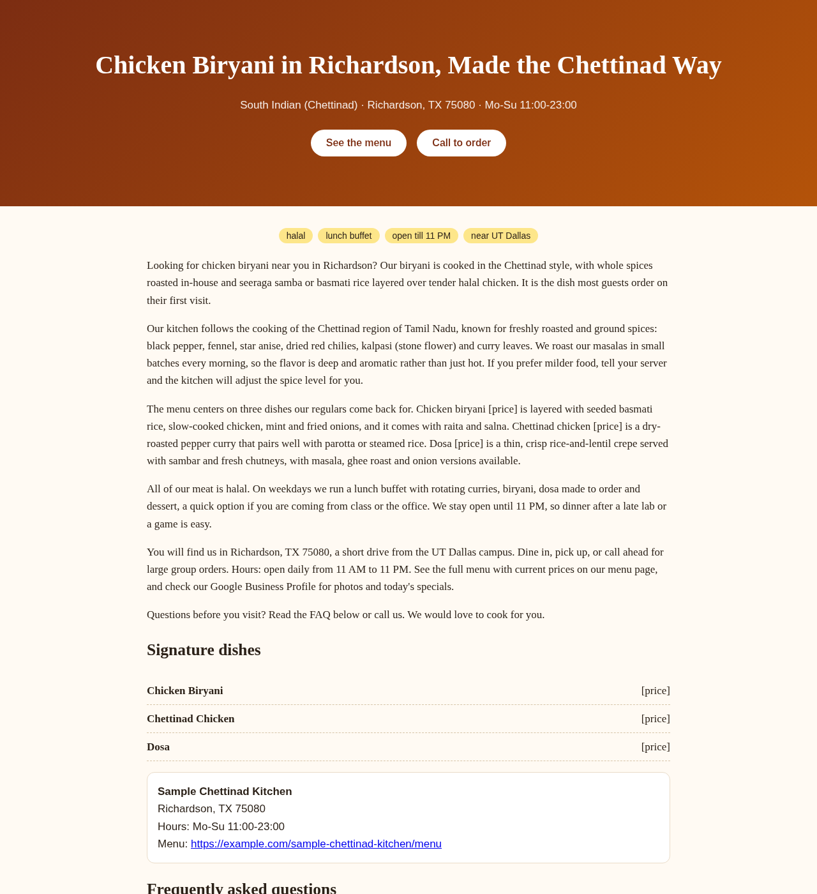

# Page One Builder — 10 Keywords on Google Maps (SEO + AEO)

**The problem:** most independent restaurants are invisible when someone types "chicken biryani near me" into Google Maps or asks ChatGPT / Gemini "where's a good halal South Indian place near UT Dallas?" Their Google Business Profile is thin, their website has no page for what people actually search, and there's no structured data an AI assistant can quote.

**What this does:** pick a restaurant → Gemini generates **20 local search keywords** grouped by intent → we pick the **top 10** → for each one you get:

| Output | What's in it |
|---|---|
| **Google Business Profile changes** | categories, description text (≤750 chars), menu items to add, photo shot list, Google Post ideas, an *honest* review-request script |
| **Website page** | title tag (≤60), meta description (≤155), H1, 300–500 word page copy with menu, prices, hours, location |
| **AEO answers** | 3 short FAQ Q&As per keyword that AI assistants can quote, plus 5 best FAQs overall |
| **Schema markup** | JSON-LD `Restaurant` (name, servesCuisine, PostalAddress, telephone, openingHours, menu, acceptsReservations, menu items, amenities) + `FAQPage` (5 FAQs) — **validated**: parsed back as JSON, required fields checked, and re-parsed out of the generated landing page `<head>` |
| **Manual rank check** | `rank_tracker.csv` with *before / after* columns: Google Maps position, top-3 map pack Y/N, AI assistant mentions Y/N, plus a step-by-step incognito checking procedure |
| **Reports** | `report.html` (clean single-page report), `landing.html` (ready-to-publish page with both JSON-LD blocks in `<head>`), `plan.json`, `keywords_20.csv` |
| **Honesty lint** | every page is checked for word count, keyword density (>3% flagged as stuffing), title/meta lengths and banned tactics |


Sample output (offline demo): [`sample_output/report.html`](sample_output/report.html) · [`sample_output/landing.html`](sample_output/landing.html) · 

## Run it in 3 steps

```bash
pip install -r requirements.txt                      # 1. install (google-genai, python-dotenv)
cp .env.example .env   # then paste your GEMINI_API_KEY into .env (never commit it)   # 2. key
python page_one.py --restaurant "Sample Chettinad Kitchen"                           # 3. run
open out/sample-chettinad-kitchen/report.html
```

Other modes:

```bash
python page_one.py --csv restaurants.csv --row 2        # any row of the organizers' CSV (0-indexed)
python page_one.py --csv restaurants.csv --all          # batch every restaurant + out/index.html
python page_one.py --offline                            # demo mode: cached sample output, no key / no wifi
python page_one.py --model gemini-2.5-flash             # or set GEMINI_MODEL
```

If no key is found or the API call fails, the tool automatically falls back to the cached sample so the demo never dies.

**Colab:** open `page_one_builder.ipynb`, add `GEMINI_API_KEY` in the 🔑 Secrets panel, Run all.

CSV columns: `name,address,cuisine,website,menu_link` (required) and optional `phone,hours,features,menu_items` (lists separated by `;`).

## Keys rule
The key is read only from the `GEMINI_API_KEY` environment variable, a local `.env` (gitignored), or Colab secrets. No key appears anywhere in this repo; `.env.example` contains a placeholder only.

## Honest methods only
This tool only recommends what Google and AI assistants reward on their own: accurate business info, real menu items, real photos, genuinely helpful pages, structured data, and asking **real** customers for honest reviews the same way every time. **No fake reviews, no fake clicks, no keyword stuffing, no incentivized reviews, no asking anyone to change rankings.** The rank tracker measures, it doesn't manipulate. Sample prices are `[price]` placeholders and the phone number is flagged as a placeholder until real data is filled in — we never invent facts.

## Judging rubric → features
*(Rubric as given on the handout; mapped to what's built.)*

| Criterion | Where it's covered |
|---|---|
| Keyword engine (20 keywords, intent groups, top 10) | `call_gemini()` with JSON mode → report §1, `keywords_20.csv` |
| Per-keyword GBP + website + AEO plan | report §2, `plan.json` |
| Schema markup, valid JSON-LD | `build_*_schema()` + `validate_schema()` → report §3, `schema_*.jsonld`, embedded in `landing.html` |
| Rank check helper | `rank_tracker.csv` + report §4 checklist |
| Clean output / demo | `report.html`, `landing.html`, offline mode |
| Honest methods | honesty lint + §5 statement |
| Keys handled safely | env / `.env` / Colab secrets, `.gitignore`, `.env.example` |
| Stretch: scale to many restaurants | `--all` batch mode over `restaurants.csv` |

Before publishing, paste each JSON-LD block into Google's [Rich Results Test](https://search.google.com/test/rich-results) and [validator.schema.org](https://validator.schema.org).

## Files
`page_one.py` (the whole tool, one file) · `page_one_builder.ipynb` (Colab) · `data/restaurants.csv` (sample row) · `sample_output/` (hand-written cached sample, clearly marked) · `tools/make_sample_output.py` (how the sample was written)
